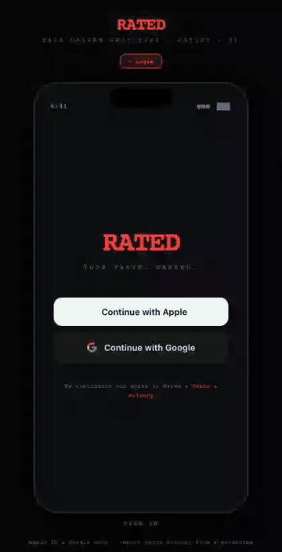
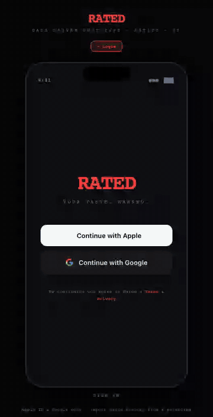

# Rated

Movie ranking + social app. Vite + React frontend (Netlify) talks to a
FastAPI + SQLAlchemy backend (host TBD). SQLite locally, Postgres in prod
via `DATABASE_URL`.

| App tour | Buy tickets |
|---|---|
|  |  |
| Home → Soon → Search → Board → Me | Shows on a movie once you and someone you follow have both rated it; opens an affiliate Fandango link. Hidden otherwise (The Dark Knight). |

The app lives under [`build/`](build/). Start there:

- [`build/README.md`](build/README.md) — repo overview, quickstart, API surface, deploy notes
- [`build/backend/README.md`](build/backend/README.md) — backend-specific docs (Make targets, Render walkthrough, schema migrations)

Two Claude skills travel with the repo for repeatable ops:

- `/build-server` — start (or restart) the local app cleanly
- `/fetch-netlify` — read live deploy state, env vars, build logs

Defined under [`build/.claude/skills/`](build/.claude/skills/).
