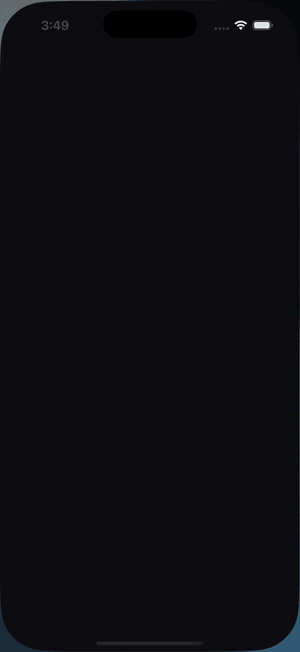
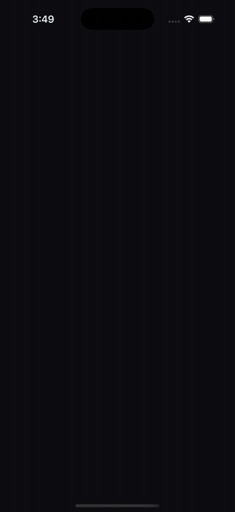
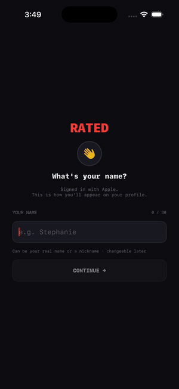

# Rated

Movie ranking + social app. Vite + React frontend (Netlify) talks to a
FastAPI + SQLAlchemy backend (host TBD). SQLite locally, Postgres in prod
via `DATABASE_URL`.

| App tour | Buy tickets |
|---|---|
|  |  |
| Home → Soon → Search → Board → Me | Shows on a movie once you and someone you follow have both rated it; opens an affiliate Fandango link. Hidden otherwise (The Dark Knight). |
| **iOS · Onboarding → pairwise rank** | **iOS · Feed → like, reply, save, review** |
|  |  |
| Sign in, pick a name and @handle, then rank first films head-to-head; each pick bisects your list and updates Elo. | Like and reply on a friend's post, open a highlight, save it, and post a 1–10 review. |
| **iOS · Profile → reorder, following, theme** | **iOS · Upcoming → Search → Board** |
|  |  |
| Rankings with streak, edit mode (drag/re-rank/remove), Following sheet, and the light/dark theme switch. | Add an upcoming film to your watchlist, search the catalog, flip leaderboard tabs. |
| **iOS · Follow → rank → Buy tickets** | |
|  | |
| Follow @cinephile99 from user search, rank Parasite, and the ticket CTA appears on its detail page. | |

The web app and backend live under [`build/`](build/); the native SwiftUI iOS
app lives under [`ios/`](ios/) ([`ios/README.md`](ios/README.md)). Start there:

- [`build/README.md`](build/README.md) — repo overview, quickstart, API surface, deploy notes
- [`build/backend/README.md`](build/backend/README.md) — backend-specific docs (Make targets, Render walkthrough, schema migrations)

Two Claude skills travel with the repo for repeatable ops:

- `/build-server` — start (or restart) the local app cleanly
- `/fetch-netlify` — read live deploy state, env vars, build logs

Defined under [`build/.claude/skills/`](build/.claude/skills/).
